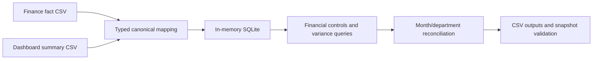
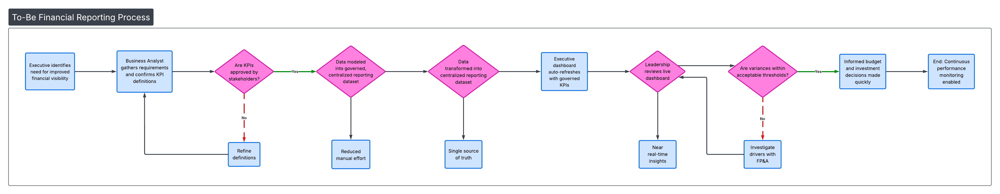

# FP&A Executive Analytics

## Overview

This project analyzes actual-versus-budget financial performance from a supplied finance fact extract and a separate dashboard-aligned summary. It combines reproducible SQL, preserved Excel financial models and a saved Power BI report with requirements and delivery documentation. The main analytical strength is reconciliation: monthly and department-level revenue totals are compared across the two supplied sources before interpretation. A portable local runner executes the five existing SQL queries and checks their outputs against the original reference CSVs. The materials support a portfolio demonstration of financial reporting, variance analysis and data controls. They do not establish access to a real finance ledger, an approved management report or a deployed planning system. Currency and business definitions remain inherited portfolio assumptions.

## Business problem and objectives

Executives need a consistent view of revenue, costs, operating income and budget variance. The project aims to separate actuals from budgets, identify department/month differences, reconcile independent extracts and make unresolved source differences visible before reporting.

## Technology stack

Python standard library, SQLite SQL, Excel financial/workflow workbooks, Power BI `.pbix`, Markdown, CSV control registers and process diagrams. No ERP connector, orchestration service or live database integration is included.

## Dataset

- [fpna_finance_fact.csv](Data/fpna_finance_fact.csv): **420 rows** with month, fiscal year, department, region, account, account category, scenario and amount.
- [fpna_dashboard_aligned.csv](Data/fpna_dashboard_aligned.csv): **30 rows** at month/department grain, containing actual/budget revenue, variance, positive Opex, operating income and gross margin.

The SQL covers six months and five departments. Preserve scenario and account category when aggregating; combining Actual and Budget would double-count incompatible populations. USD is assumed in the inherited reporting. No license or independently verified source authorization accompanies the extracts.

## Architecture and workflow



## Processing and SQL implementation

Required fields and numeric inputs are validated during ingestion. Q01 groups by scenario/category; Q02 builds monthly actual/budget and cost comparisons; Q03 reports department revenue variance; Q04 constructs the union of source keys and left-joins both sources so missing matches remain visible; Q05 detects missing actual/budget populations. Reconciliation distinguishes `MATCH`, `MISSING SOURCE` and `UNRESOLVED DIFFERENCE`. Original input rows and historical analysis files are not rewritten.

## Dashboard, financial model and findings

The saved [Power BI dashboard](Dashboard/FPnA_Executive_Analytics_Dashboard.pbix) has two pages, `Executive Summary` and `(Analysis Page`, containing 16 and 11 visual containers. Their package/layout structures parse; native refresh and DAX evaluation remain untested. [Excel files](Excel/) include the executive performance model, a larger project workbook, requirements traceability, backlog and UAT examples. Cached workbook values are not evidence of recalculation.

The SQL reproduced the supplied [result snapshots](Analysis/RESULTS.md):

| Measure | Amount |
| --- | ---: |
| Actual revenue | $13,328,601 |
| Budget revenue | $13,330,369 |
| Revenue variance | −$1,768 |
| Actual COGS | $5,399,711 |
| Actual Opex | $6,480,942 |
| Actual operating income | $1,447,948 |

All **30** month/department revenue pairs reconcile. Q05 finds no missing actual/budget category populations in this extract. These checks do not validate external ledger accuracy or establish actual sign-off. October operating income is negative in the supplied monthly result, requiring interpretation rather than an invented causal explanation.

## Visual documentation



## Project structure

```text
Data/        finance facts and dashboard summary
SQL/         five analytical queries and reference pack
scripts/     portable ingestion, execution and validation
Analysis/    original outputs and data profile
Dashboard/   Power BI report
Excel/       financial models and delivery templates
Docs/        business and technical specifications
Delivery/    illustrative controls and planning records
Diagrams/    process illustrations
Deck/        original PDF and PowerPoint presentation
```

## Installation and execution

Python 3.10+ with SQLite 3.25+ is sufficient for the local analysis. No third-party Python packages, API keys or cloud services are required.

```sh
python3 scripts/run_analysis.py
python3 scripts/validate.py
```

Run from this project directory. Input paths are resolved from the script location, so execution also works from another working directory. Results are written to ignored `artifacts/`; the supplied `Analysis/` snapshots remain unchanged. The validator compares every Q01–Q05 output field against those snapshots. See [the runbook](Docs/09_Operations_Runbook.md) for failure handling.

## Validation and limitations

All five supplied SQL queries were executed and reconciled locally. Source CSVs are preserved; ingestion validates required columns, numeric types and finite values. This is snapshot reconciliation, not proof of real-world accuracy or stakeholder approval. See [audit results](AUDIT.md).

The original documentation describes a shared Local_System web application, role controls, persistent UAT and transaction history. That application was **not supplied** in this extracted folder. It is not represented as an implemented feature of this standalone copy. Delivery records, proposed approvals and UAT examples remain historical portfolio artifacts. Native application behavior and external integrations require separate testing.

## Attribution and license

The supplied materials identify **Jamie Christian** as their original portfolio author. That authorship, document credits and historical planning evidence are retained. This cleaned copy is prepared for `amrut-mdsh`; it does not claim exclusive authorship or production deployment. No LICENSE was supplied. Public redistribution rights for code, data, dashboards and screenshots must be confirmed separately; see [ATTRIBUTION.md](ATTRIBUTION.md).

## Future improvements

Confirm fiscal definitions and source ownership, recalculate the workbooks in Excel, test the report in Power BI Desktop and add ledger-based independent controls before recurring executive use.
